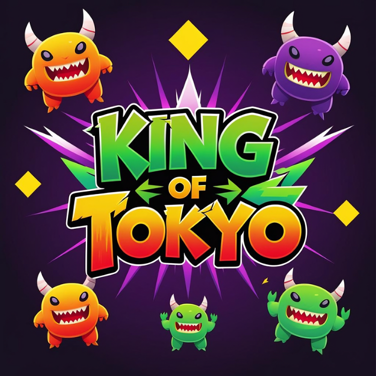

# king_of_tokyo

Welcome to our game project! 👾

This app is inspired by **King of Tokyo** and reimagined with our own custom features and designs.
We built it in **Android Studio (Kotlin)** and created our own avatars and gameplay logic while staying true to the original concept.

  

---

## 👥 Team Members

* **Yasmine MAZGHI**
* **Safia FIRITI**
* **Hiba IAZZA**
* **Douae RATBI**

---

## 🎨 Project Mockup

You can view the project mockup here ✨:
[https://www.figma.com/design/6eladjPKjI1MvSXrC4vguY/KIngOfTokyo-prototype?node-id=0-1&t=seeLONMRcxxS52DD-1](https://www.figma.com/design/6eladjPKjI1MvSXrC4vguY/KIngOfTokyo-prototype?node-id=0-1&t=seeLONMRcxxS52DD-1)

---

## 📌 Work Distribution

The task breakdown and contributions are documented in the following Google Doc:
[https://docs.google.com/document/d/1Jzyb5PPOqdaORT5xRdsicVLJKMYlVh-TQF3uKnpoogQ/edit?usp=sharing](https://docs.google.com/document/d/1Jzyb5PPOqdaORT5xRdsicVLJKMYlVh-TQF3uKnpoogQ/edit?usp=sharing)

## 📌 Video Link

You can watch the project video here:  
[https://drive.google.com/file/d/1rKsF1CYXwIiD-J5inDiOwo5aTqgx4OD-/view?usp=sharing](https://drive.google.com/file/d/1rKsF1CYXwIiD-J5inDiOwo5aTqgx4OD-/view?usp=sharing)

---

## 🚀 How to Run

1. Clone the repository
2. Open in Android Studio
3. Run the app on an emulator or a device

---
